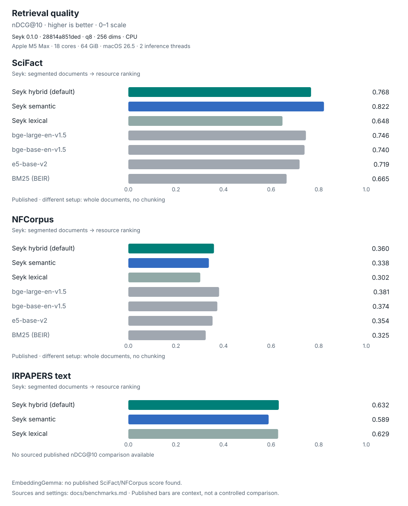

<p align="center">
  
</p>

<p align="center">
  <a href="#license"></a>
  <a href="Cargo.toml"></a>
</p>

Local hybrid search over your own files and code: semantic meaning, BM25
keywords, and file names. Semantic retrieval runs on Google's
[EmbeddingGemma 2](https://huggingface.co/google/embeddinggemma-2).
Use the CLI, embed the Rust library, or connect an agent through MCP.

Ask a question in your own words, or type an exact name, and get back the
passages that match. Meaning, keywords and file names are searched together:

```console
$ seyk search "turning into my dad" ~/notes -n 1
1.000  father.md:1-3  § Father  [meaning 0.70]
       He used to slam the door when he was angry. Last week I caught myself doing exactly the same thing, and my son flinched the way I used to.

$ seyk search "INC-18372" ~/notes -n 1
1.000  work.md:1-3  § Work  [meaning 0.76+words]
       Ship the pricing page before the conference. INC-18372 is still open: the old page lists the beta plan.

$ seyk search "father.md" ~/notes -n 1
1.000  father.md:1-3  § Father  [meaning 0.74+words+name]
       He used to slam the door when he was angry. Last week I caught myself doing exactly the same thing, and my son flinched the way I used to.
```

(Real output from a three-note folder. The first match shares no words with the
question; the tag in brackets says what found each hit.)

It is a Rust library first. The `seyk` CLI is a thin layer over it, so other
applications can embed the same engine.

Seyk returns relevant resources and exact locations inside them. It does not
generate answers or summaries. Audio retrieval and on-demand speech-to-text
extraction are [opt-in](#speech-to-text-extraction-opt-in); scanned PDFs support
image-based retrieval, with [OCR still a follow-up](#pdfs).

## Benchmarks



nDCG@10 measures how well the first ten results rank relevant documents, giving
more credit to relevant results near the top. Scores range from 0 to 1; published
bars use different models and whole-document setups, so they provide context
rather than a controlled comparison with Seyk's segmented-document retrieval.

Seyk 0.1.0 at `28814a851ded` · EmbeddingGemma 2 · q8 · 256 dimensions · CPU ·
Apple M5 Max (18 cores, 64 GiB), macOS 26.5 · 2 inference threads.
Hybrid trails semantic-only on SciFact; fusion tuning is tracked in todo 4542.
See [full results, sources and reproduction steps](docs/benchmarks.md#published-retrieval-comparison).

## Why EmbeddingGemma 2

- **Small and local.** The text part is 270M parameters. It runs on a laptop CPU,
  so your notes never leave the machine.
- **Asymmetric retrieval.** Queries and documents get different task prompts
  (`task: search result | query: …` and `title: … | text: …`). That is what lets a
  question match a passage that answers it.
- **Matryoshka dimensions.** Vectors can be cut to 512, 256 or 128 numbers with
  little quality loss. The default is 256 (MTEB multilingual 60.41 vs 61.36 at 768,
  per the model card), a third of the storage.
- **One space for text, code, images, audio and video.** A text query can find a
  photo of a whiteboard. Text and images work today; see
  [Supported resources](#supported-resources).

## Installation

Prebuilt binaries for macOS (Apple Silicon), Linux (x86_64 and ARM64) and
Windows (x86_64) are attached to each
[release](https://github.com/CertaMesh/seyk/releases). While the repository is
private, install with the GitHub CLI:

```bash
gh api repos/CertaMesh/seyk/contents/scripts/install.sh \
  -H "Accept: application/vnd.github.raw" | sh
```

The script picks your platform, checks the SHA-256 checksum and installs to
`~/.local/bin` (set `SEYK_INSTALL_DIR` to change that).

- **Linux needs glibc 2.38 or newer** (Ubuntu 24.04, Debian 13, Fedora 39 and
  later), because ONNX Runtime's prebuilt library does.
- **There is no Intel Mac build**, because ONNX Runtime publishes no prebuilt
  library for it.

From source (Rust 1.89 or newer):

```bash
cargo install --locked --git https://github.com/CertaMesh/seyk
```

The binary is self-contained. ONNX Runtime is linked statically; its prebuilt
library is downloaded by the `ort` crate **at build time**. For a fully offline
build, set `ORT_SKIP_DOWNLOAD=1` and point `ORT_LIB_LOCATION` at a local ONNX
Runtime build.

Older Seyk binaries reset caches whose schema they do not recognize. Use separate
`--cache-path` values when running builds with different cache schemas.

## Model setup

Download the weights once (about 0.5 GB for the default 8-bit text and vision models):

```bash
seyk model download            # 8-bit weights (default)
seyk model download --precision fp32   # full precision, ~1.8 GB
seyk model info                # where they are, whether they are present
```

This is the only command that uses the network. It fetches the ONNX export
`onnx-community/embeddinggemma-2-ONNX`, pinned to commit `daa72c5`, into the
standard Hugging Face cache. Searching never downloads anything: if the weights are
missing it stops and tells you to run `model download`.

To use weights you already have, pass a directory with the same layout
(`tokenizer.json`, `onnx/model_quantized.onnx` + `.onnx_data`, …):

```bash
seyk search "…" ~/notes --model /path/to/embeddinggemma-2-ONNX
```

Precision: `q8` (default) or `fp32`. There is deliberately no `fp16`: the model card
warns that EmbeddingGemma 2 overflows float16 and silently returns NaN or degraded
vectors.

## CLI

```bash
# Search a folder (recursively). Embeddings are cached as you go.
seyk search "how I fixed my sleep" ~/notes

# Several paths, files or folders
seyk search "ideas for the pricing page" ideas.md projects/

# Several phrasings of the same need; each result keeps its best score
seyk search "where do we retry failed payments" -q "payment retry logic" ~/code/shop

# Only Markdown, skip drafts, top 5, hide weak matches
seyk search "advice I got about hiring" ~/notes \
  --include '*.md' --exclude drafts --limit 5 --min-score 0.55

# Nothing written to disk
seyk search "query" ./notes --no-cache

# Machine-readable output (mirrors the library's SearchResults type)
seyk search "query" ./notes --json

# Optional: embed everything up front so later searches are instant
seyk index ~/notes

# Keep the index fresh: index once, then re-index whatever changes
seyk index --watch ~/notes

# Serve search to AI agents over MCP (see "Agents" below)
seyk mcp ~/notes

# Inspect or wipe the cache
seyk cache stats
seyk cache scrub  # erase deleted postings/WAL frames, preserving live records
seyk cache clear
```

| Flag | Meaning |
|---|---|
| `-n, --limit` | Number of results (default 10) |
| `-q, --also` | Another phrasing to search for too (repeatable) |
| `--mode` | `hybrid` (default: meaning + keywords + file names), `semantic` or `lexical` |
| `--min-score` | Hide meaning matches below this cosine similarity (keyword and name matches are kept) |
| `--dimension` | 768, 512, 256 (default) or 128 |
| `--precision` | `q8` (default) or `fp32` |
| `--include` / `--exclude` | Globs; a pattern without `/` matches the file name |
| `--hidden` | Also search dotfiles and dot-directories |
| `--no-cache` | Embed in memory only |
| `--no-preview` | Skip preview reads; JSON hits retain `"preview": null` |
| `--json` | JSON output |
| `--text-only` | Skip loading the vision encoder; images are skipped |
| `--model` | Model directory or `REPO[@REVISION]` |
| `--cache-path` | Use a different cache file |

### Keyword search

The default `hybrid` mode combines meaning, BM25 keyword relevance, and file-name
matches. Use `lexical` to rank exact terms, identifiers, and names without
embedding the query:

```sh
seyk search "INC-18372" ~/notes --mode lexical
seyk search "Session::restore" ~/code --mode lexical
```

The CLI still loads a model to index new or changed files; lexical query ranking
does not make this a model-free indexing mode. See [scores and tags](#scores-and-tags)
for how the three match types are combined.

### Extract a search hit

Search locates evidence; extraction reads a chosen hit and verifies its full
resource hash before returning the exact UTF-8 byte range. It preserves Markdown,
code, whitespace and line endings. If the source changed, extraction fails with
an error instead of returning a different passage.

```sh
seyk search "planting basil" ./notes --json --no-preview > hits.json
seyk extract --from-json hits.json --hit 0 --json

# Or pipe search output directly; the default hit index is zero.
seyk search "planting basil" ./notes --json --no-preview -n 1 |
  seyk extract --from-json - --json
```

For raw text, extract writes the exact bytes without an added newline; PDF text
also needs no model. Audio STT is optional and clearly labelled (see below).
Extraction needs no cache or network. Input must be a complete search JSON envelope
at `schema_version: 2`, `3`, `4`, `5` or `6`, not a bare hit. The extraction document uses
version 6 and contains `text`, `source`, `locator`, `metadata`, and optional extraction provenance;
`metadata.content_hash` is the hash of the **whole source**, not just the passage.
The `--no-preview` option sets `preview` to
null. This flag skips preview reads; indexing still reads source content.

Raw text ranges and PDF page-text ranges are supported. Images, whole-resource and other locators return
an unsupported-extraction error. MCP also exposes an explicit
`extract` tool accepting a selected MCP hit; it verifies the hash and confines
reads to the session roots. Search never transcribes.

### Audio (opt-in)

Build with `cargo build --release --features audio`, then provision the extra
q8 encoder with `seyk model download --audio` (about 325 MiB). This command only
downloads the two pinned audio files; provision the ordinary model separately.
Default release builds retain their existing feature set.

`seyk search "repairing a bicycle" ./recordings` embeds sound directly, with no
transcription. WAV, FLAC, MP3 and AAC-LC/ALAC in M4A are decoded locally into
10-second windows every 8 seconds. Results use the existing half-open `time`
locator (`start_ms`, `end_ms`) and have no transcript or preview. Explicit audio
extraction requires `audio-stt` (see below); search needs no STT model.
Missing audio weights skip individual audio files; text, images and PDFs still
work. Search never downloads weights.

The default duration ceiling is two hours, configurable with
`--max-audio-duration-secs`. Decoding/windowing uses bounded memory; it never
holds whole-file PCM in RAM. Over-limit sources are skipped entirely.
Complex MP4 edits,
multiple tracks, HE-AAC/SBR and changing sample formats are rejected. MP4 edit
lists or iTunSMPB remove encoder priming/padding; files without timing metadata
use their decoded-sample timeline. See the [audio report](docs/architecture.md#phase-5a-audio-retrieval)
for timing, parity and retrieval measurements.

### Speech-to-text extraction (opt-in)

Build with `cargo build --release --features audio-stt`, then explicitly run
`seyk model download --stt` to install the pinned Xenova Whisper tiny FP32
model (about 255 MiB). Inference stays offline. A local exact asset directory
can be selected with `--stt-model-dir` or `SEYK_STT_MODEL_DIR`; it receives the
same manifest check, including rejection of unexpected files.

Select an audio hit using `seyk extract --from-json hits.json --hit 0 --json`.
Each half-open interval is capped at 30 seconds; longer intervals return a
typed error. Language is detected from that hit, or set with `--stt-language en`.
Human output says **Machine transcript (may contain errors)**. JSON includes
machine-transcription provenance, verified sample bounds, model manifest hash,
language and `no_speech`; it does not claim word-level timestamps. Silence has
no detected language. Transcripts are never cached or logged, and search,
indexing and previews never invoke STT. See the
[implementation and model gate](docs/architecture.md#phase-5b-2-on-demand-speech-to-text-extraction).

### PDFs

Normal builds include `pdf-render` and image embedding. Minimal library
consumers can enable `pdf` for embedded text or `pdf-render` for page rendering.
PDF pages with embedded text participate in semantic and keyword search. Hits
use `page_text`: a 1-based physical page, half-open UTF-8 byte range in the
extracted page text, extraction version and page-text hash. These are not byte
offsets in the PDF file. Explicit extraction checks the full PDF hash before
decoding, then verifies the derived page hash before returning text.

Scanned PDFs are found by meaning: pages without usable embedded text are
rendered as whole-page images, respecting crop, rotation and a white background,
then embedded at a maximum long edge of 2048 pixels. Hits use a 1-based `page`
locator and have no text preview. Their text cannot be extracted yet: `extract`
returns an explicit OCR-unavailable error. OCR is tracked as a follow-up; no OCR
model is loaded or downloaded. Mixed PDFs keep their embedded-text hits and
scanned-page hits. With `--text-only`, a text-only embedder or a build without
`pdf-render`, image pages produce separate page diagnostics while supported text
pages remain searchable. Scan indexing is much slower than text indexing:
rendering measured about 34 ms/page in the compatibility spike, while image
embedding takes seconds per page on CPU. The synthetic end-to-end scan test
measured about 6.7 s/page with one CPU thread. Use `--text-only` to skip image
embedding when indexing or searching large PDF collections.

Corrupt image streams can be omitted by the renderer. A page with image XObjects
that renders nearly uniform gets “scanned page could not be rendered” instead of
a hit; very faint or nearly blank scans can also trigger this guard. Partial
image omissions on otherwise nonblank pages remain a recall limitation. Reading
order, nonstandard fonts and sparse text over scanned pages remain limitations.
Every page content reference must resolve, decompress completely and pass strict
content decoding before any page output is accepted. Content streams currently
support no filter or FlateDecode without DecodeParms; other filters/parameters
are rejected explicitly because upstream decompression can silently return a
prefix after errors. PDFs over 512 pages, 1 MiB extracted text per page or 32
MiB total extracted text are rejected explicitly; other resources continue
indexing. These output limits do not bound upstream decompression, CPU time or
memory use.

CLI/MCP output now uses JSON schema 4. `seyk extract` accepts schema 2, 3 and 4
search envelopes. Cache schema 5 adds nullable media type and preserves existing
vectors, profiles and keyword indexes. Older binaries may reset a schema-5
cache, so keep a copy if downgrading.

Library integrations that install a `log` logger **must filter `pdf_extract`,
`hayro_interpret`, `hayro_syntax` and `hayro_font` to Off**: upstream
diagnostics can contain document data. Seyk core installs no logger. On the first
PDF parse, core installs one permanent panic dispatcher with `OnceLock`, capturing
the previous hook. Per-parse RAII guards change only thread-local suppression:
parser panics are recorded as sanitized diagnostics without printing, while
unrelated threads delegate to the captured hook. A component installing a later
hook replaces the dispatcher; parser panics are still caught but may then print.
Seyk never removes or overwrites that later hook. If the first parse starts
during unwinding, dispatcher installation is deferred until a normal parse;
that first parse can use the existing hook and may print. Neither mechanism contains
aborts, out-of-memory failures, hangs or hostile allocation behaviour.

PDF parser failures are isolated per page: valid pages keep their original page
numbers, and failed pages appear in `sync.page_diagnostics` with typed `code`
and sanitized `reason`. If every page fails, the resource also appears in
`sync.skipped`; `sync.skipped_counts` groups resource counts by code and reason.
CLI summaries group skips by code (at most five groups). MCP reports inline
diagnostics and watcher diagnostics in a separate `index_diagnostics` field;
`index.state` keeps its existing values, including `ready`. Protocol version 6 adds
these diagnostic fields; the cache schema remains unchanged. MCP page details are
capped at 128 entries, with the total reported separately.

An unchanged PDF is not re-parsed or rewritten after a deterministic failure.
Page diagnostics are replayed from an engine-local map keyed by resource and
preparation descriptor. They are not persisted: a fresh process reports them
only for resources it actually parses, and cannot replay failures from an
already-fresh persistent cache. Changed bytes or preparation versions trigger
a new parse.

Raw lopdf text fallback is deferred: lopdf 0.42 prefers Encoding over ToUnicode
and silently substitutes standard encoding after some font errors. That can
produce incorrect evidence. Page isolation recovers unaffected pages without
guessing glyph mappings. Subprocess isolation remains tracked in Solo #4374.

### Scores and tags

In the default **hybrid** mode, three lists are ranked separately and merged by
position (reciprocal rank fusion):

- **meaning**: cosine similarity between the question and each passage;
- **words**: keyword relevance (BM25) over the text, heading, file name and path;
- **name**: the query names the file (`father.md`, `father` or `notes/father.md`).

The hybrid score only depends on **where a hit ranked in each list**, scaled so
1.000 means first everywhere something was found. It says nothing about how
good the match is in absolute terms: with three unrelated notes, the third one
still scores close to 1. **The tag shows the strength**: `meaning 0.70` is the
cosine, `words` means the keywords matched and `name` means the file name did.

Keywords count fully for names, identifiers (`INC-18372`, `Session::restore()`)
and one- or two-word queries. In a question written in prose they count less
(0.3), so incidental shared words only break ties between passages of similar
meaning.

`--mode semantic` gives the old behaviour: the score is the cosine itself. Use
it to rank within one search; it is not a calibrated probability, and unrelated
text rarely scores near zero, so pick a `--min-score` by looking at your own
results. `--mode lexical` never embeds the query. The CLI still loads the model
and uses it to index new or changed files before searching.

## Agents (MCP)

`seyk mcp` is a [Model Context Protocol](https://modelcontextprotocol.io) server
over stdio. Agents get one tool, `search`, that takes one to eight phrasings and
returns ranked passages as path, line range, heading, score, preview and
`matched` (`meaning`, `words`, `name`). An optional `mode` switches between
`hybrid` (default), `semantic` and `lexical`. The agent
then reads those lines itself and writes the answer. Seyk never generates text.

```bash
# Claude Code: make your notes searchable in every session
claude mcp add --scope user seyk -- seyk mcp ~/notes

# Or per project, for a codebase
claude mcp add seyk -- seyk mcp .
```

- **One model for every session.** `seyk mcp` is a small relay (about 9 MB).
  The first one starts a shared background daemon that loads the model once,
  owns the cache and watches every folder any session asked for. Five agent
  sessions cost one model's memory, not five. The daemon exits after 15 minutes
  without sessions, and the next `seyk mcp` starts it again.
- **The model stays loaded.** After the first call, a search takes well under a
  second on a warm cache.
- **Indexing runs in the background.** On start the server indexes its folders,
  then re-indexes on change. Searches never wait for it: they answer from what is
  already indexed and report `index.state` (`loading_model`, `indexing` with
  progress, `ready`, `pass_failed` or `stopped`).
- **Confined to its folders.** The tool refuses paths outside the folders the
  server was started with.
- **For code, it complements grep.** Hybrid search finds `retryPayment` by name
  too, but grep is still the right tool for every exact occurrence of `retryPayment(`.

```bash
seyk daemon status    # pid, sessions, and each watched folder's index state
seyk daemon stop      # connected sessions lose the tool until they restart
seyk mcp --standalone ~/notes   # no daemon: one process per session
```

Sessions only share a daemon when they use the same model options
(`--model`, `--dimension`, `--precision`, `--text-only`, `--cache-path`) and the
same package and JSON schema versions. Builds with the same values share an
endpoint, even when their implementation differs. The daemon is Unix-only; on
Windows `seyk mcp` always runs standalone.

For automatic local-content collections on Unix, opt into a fixed narrower
policy with `seyk mcp --local-content /absolute/real/folder`. It requires explicit
directory roots and always runs in-process, bypassing the daemon. MCP initialize
advertises `serverInfo.name: seyk-local-content-v1`; clients relying on this
policy must require that name and JSON schema 6, and refuse an older helper
instead of dropping the flag. Use `--no-watch` to disable background indexing.

The same policy filters discovery and every content read/open: hidden paths,
`.icloud` markers, Library/cache/caches/build/dist/target/node_modules/__pycache__
directory names (ASCII case-insensitive), and structural Rust outputs under
target(s)/[up to two namespace components]/debug or release followed by
incremental/.fingerprint/build/deps/examples are excluded. Ordinary `targets/data`
remains eligible. Include/exclude options cannot widen this fixed policy. Roots
and file/directory links are refused, including in-root aliases; supply real
POSIX paths, since `/tmp` can itself be a symlink on macOS. Roots are pinned by
directory descriptors and current device/inode checks. Other Seyk modes retain
their existing discovery and explicit-link behavior.

Observed macOS dataless files are refused before content open, with descriptor
type/identity/flags checked again afterward. Neither this mode nor the ordinary
filesystem guard guarantees atomic prevention of hydration: cloud state can
change between the metadata check and open, and directories can move while
traversed. Discovery is metadata-only and path-based, with the fixed policy and
confined metadata checks before descending. A returned seekable audio handle
is not rechecked at each later read. Model/cache/materializer reads and custom
resource providers are separate from this content boundary.

See [MCP indexing and inline search latency](docs/mcp.md) for how inline sync
can wait behind a watcher indexing another root.

**Privacy.** Seyk itself sends nothing anywhere, but a cloud-hosted agent sends
the passages it reads to its provider. Point the server only at folders you are
happy for that agent to read.

## Use Seyk as a search engine

```rust
use seyk::embedder::gemma::{GemmaConfig, GemmaEmbedder};
use seyk::{Dimension, ResourceLocator, SearchEngine, SqliteCache};

let embedder = GemmaEmbedder::load(GemmaConfig {
    dimension: Dimension::D256,
    ..Default::default()
})?;

let engine = SearchEngine::builder()
    .embedder(embedder)
    .cache(SqliteCache::open_default()?) // omit for an in-memory, ephemeral cache
    .build()?;

let results = engine
    .search("what did we decide about pricing?")
    .paths(["~/notes"])
    .exclude("drafts")
    .limit(10)
    .execute()?;

for hit in &results.hits {
    match &hit.locator {
        ResourceLocator::Text { line_start, line_end, .. } => {
            println!("{:.3} {}:{line_start:?}-{line_end:?}", hit.score, hit.resource)
        }
        ResourceLocator::WholeResource => println!("{:.3} {}", hit.score, hit.resource),
        other => println!("{:.3} {} {other:?}", hit.score, hit.resource),
    }
}

// Optional cache warming
engine.index().paths(["~/notes"]).execute()?;
```

Each `SearchHit` carries a resource URI, a modality-independent
`ResourceLocator` (`Text` byte and line range, `Page`, `Time`, `ImageRegion`, or
`WholeResource`),
the score, the resource metadata (modality, size, mtime, content hash), the
Markdown heading path and an optional short preview.

Explicit extraction in Rust:

```rust
let results = engine.search("planting basil")
    .paths(["./notes"])
    .previews(None)
    .execute()?;
if let Some(hit) = results.hits.first() {
    let content = engine.extract(hit)?;
    print!("{}", content.text);
}
```

`SearchEngine::builder().extractor(custom)` registers a synchronous
`Extractor: Send + Sync` before the default `TextExtractor`. Custom extractors
receive full, hash-verified bytes; the first supporting extractor wins and its
errors propagate. For model-free library extraction, use
`extract_resource(&provider, &TextExtractor, &hit.resource, &hit.locator,
&hit.metadata)`. Direct low-level `Extractor::extract` calls require the caller
to verify bytes first. Neither entry point adds an authorization layer.

Resource identity migration (Phase 2): replace `hit.resource.path()` with
`hit.resource.to_file_path()`, which returns `Option<PathBuf>`. Use the URI's
`Display` implementation when displaying any resource, as in the example above;
use the optional path when opening a local file. `ResourceId::from_path(path)?`
now requires an absolute path and returns a `Result`. Request `.paths(...)`
still accepts relative paths and `~/...`.

CLI JSON objects and MCP search responses include `schema_version: 6`.
Every hit also includes `match` (`SearchHit::r#match` in Rust): optional one-based
`semantic_rank`, `keyword_rank` (BM25), and `filename_rank`, plus `matched_terms`
containing only normalized query tokens confirmed by the keyword index. Ranks
precede fusion and the final limit; `null` means the leg did not contribute.
The additive field leaves schema version 6, existing scores/signals and ranking
unchanged; older JSON defaults to empty provenance. See
[match provenance](docs/mcp.md#per-hit-match-provenance) for token and compatibility details.
A search hit's `resource` is a URI (`file:///notes/my%20note.md`); MCP also keeps
an explicit decoded `path`. URI identity preserves non-UTF-8 Unix path bytes;
the JSON path is a display aid and can contain replacement characters.
See the [Phase 2 report](docs/architecture.md#phase-2-report-resource-identity-and-providers)
for all API changes and cache upgrade details.

The engine uses `ResourceProvider` for enumeration, reads, freshness and deletion
checks. `FsProvider` is the default. `ResourceProvider`, `ResourceScope`,
`ProvidedResource` and `ResourceVersion` may change before 1.0; filesystem is the
only supported provider. There are no remote connectors.

Other backends plug in through the `Embedder` trait:

```rust
pub trait Embedder: Send + Sync {
    fn identity(&self) -> &ModelIdentity;          // persisted with every cached vector
    fn supports(&self, modality: Modality) -> bool;
    fn embed_batch(&self, requests: &[EmbeddingRequest<'_>]) -> seyk_embed::Result<Vec<Embedding>>;
}
```

`ResourceInput` already has `Text`, `Image`, `Audio` and `Video` variants. An
embedder declares what it supports, and the engine skips the rest with a reason
instead of guessing.

Cargo features: `onnx` (EmbeddingGemma 2 backend), `image` (image resources) and
`cli` (the binary) are on by default. A library user who only wants the engine with
their own embedder can use `default-features = false`.

## Use only the EmbeddingGemma 2 backend

The crates are **not on crates.io yet**. Use Git dependencies:

```toml
[dependencies]
seyk-embed = { git = "https://github.com/CertaMesh/seyk" }
seyk-embeddinggemma = { git = "https://github.com/CertaMesh/seyk" }
```

```rust
use seyk_embed::{Embedder, EmbeddingTask, cosine_similarity};
use seyk_embeddinggemma::EmbeddingGemma2;

// Uses already-provisioned local files; loading never downloads weights.
let model = EmbeddingGemma2::builder().dimension(256).build()?;
let a = model.embed_text("customer cannot log in", EmbeddingTask::SentenceSimilarity)?;
let b = model.embed_text("user is locked out of their account", EmbeddingTask::SentenceSimilarity)?;
println!("{}", cosine_similarity(&a, &b)?);
```

This entry point brings no search engine, SQLite, filesystem discovery, CLI, or
agent framework. It supports semantic similarity, clustering, recommendations,
retrieval embeddings, nearest-label classification/routing, and custom vector
applications. It does not perform search by itself.

See [standalone embedding usage and API migration](docs/embedding.md) for batch
requests, offline model files, optional images, supported tasks, examples, and
migration from the old `Embedder` and cache write APIs.

## How caching works

The original files stay the source of truth. The cache holds file metadata,
segment locations, vectors and a keyword index (see the privacy note below).

There are three ways to search:

1. **Lazy cache (default).** For each file: if size and modification time match
   the cache, its vectors are reused without reading it. Otherwise the file is read
   and hashed. If the content hash is unchanged only its metadata and version are updated.
   Otherwise it is re-segmented, and only segments whose exact model input is new
   are sent to the model. Vectors are saved after every batch, so an interrupted
   first search keeps its progress.
2. **Ephemeral (`--no-cache`).** Everything happens in memory and is dropped.
3. **Explicit indexing (`index`).** Runs the same update ahead of time and also
   removes cache entries for files deleted under the indexed folders. It is an
   optimisation, never a requirement.
4. **Watching (`index --watch`, and `mcp`).** Indexes once, then repeats the same
   incremental update about 1.5 s after files stop changing. Changes inside
   `.git/`, `target/`, `node_modules/` and similar folders are ignored.

Stale vectors cannot be reused. Every vector is stored under a *profile*: a hash of
the model id, exact weights revision, precision, dimension, normalisation, both
prompt templates, maximum input length and segmenter version. Within a profile it
is keyed by a hash of the exact text sent to the model. Change any of these and
the old vectors are simply never looked up. `cache stats` lists the profiles.

## Where things are stored

| What | Where (macOS) | Where (Linux) |
|---|---|---|
| Embedding cache | `~/Library/Caches/seyk/cache.sqlite3` | `~/.cache/seyk/cache.sqlite3` |
| Model weights | `~/.cache/huggingface/hub/` (or `$HF_HOME/hub`) | same |
| Hard links to the ONNX files (a copy only if the cache is on another disk) | `~/Library/Caches/seyk/models/` | `~/.cache/seyk/models/` |
| Daemon socket and log (`seyk mcp`) | `~/Library/Caches/seyk/daemon-*.sock`, `daemon.log` | `~/.cache/seyk/` |
| Configuration | none: flags plus `SEYK_MODEL`, `SEYK_CACHE` | same |

The hard links exist because ONNX Runtime refuses weight files that live behind the
Hugging Face cache's symlinks.

**Privacy.** Seyk sends no files, queries or embeddings over the network. Treat the cache
as sensitive. Embeddings can leak information about the text they came from, and
the keyword index (a SQLite FTS5 table) stores **which words occur in each passage
and how often, not their order**. Each field is tokenized and sorted before it
is indexed. These word frequencies are still sensitive, like embeddings. The
cache directory is created `0700` and the file `0600`. SQLite
`secure_delete=ON` zeroes deleted ordinary records in updated pages; zeroing of
the main database and removal of historical WAL images complete at the next
scrub's checked checkpoint. Removed ordinary records and keyword postings are
**erased after the next scrub**, not necessarily when a file is removed or
replaced. A scrub runs FTS5 `optimize` for each pending profile, then checks a
WAL TRUNCATE checkpoint. Forensic tests with the bundled SQLite verify removal
of readable prefix-compressed suffixes, not just whole token strings. A word
still present in another live record remains indexed. Scrub cost depends on the profile's index size.

A scrub happens at the end of a one-shot `seyk index` or `seyk search` command,
when cleanup is pending. Watcher, daemon and MCP use a background worker after
about **60 seconds with no further changes**; it never scrubs inline in an MCP
request or during an indexing pass. A running scrub holds the cache mutex, so
a concurrent search can be delayed by the scrub's duration. Further writes,
including fresh inserts while cleanup is already pending, postpone it. Continuous
changes can delay scrubbing indefinitely. The worker retries blocked cleanup at roughly 60-second
intervals. It sleeps until the quiet-period/retry deadline, or checks every 60
seconds when idle to notice other processes' writes, rather than polling every
second. Observing another process's write starts a fresh quiet period. If cleanup
is pending, a short-lived MCP process or `seyk index --watch` stopped within about
60 seconds of its last change leaves the scrub pending; there is no scrub on exit.
Engine drop wakes an idle worker immediately. An active scrub may finish its
current iteration; drop does not cancel or join it.

Run `seyk cache scrub` to scrub immediately without deleting live records.
`seyk cache clear` deletes the entire index, runs `VACUUM`, and truncates the WAL,
including cleanup-marker frames. Schema migrations also mark compaction pending;
VACUUM is performed by the next scrub. Fresh inserts, unchanged metadata touches,
identical vectors and zero-row deletions do not request a scrub or an explicit
checkpoint. Core/library index and search APIs defer scrubbing; integrations can
call `SearchEngine::scrub_cache`, `EmbeddingCache::scrub`, or start the idle worker.

Pending profile scrub, WAL cleanup and migration/clear compaction are durable
`meta` keys, with no cache schema or profile change. They survive interruption; pending work stays recorded until the scrub's
checked TRUNCATE succeeds. If a reader
blocks it, the marker stays and a warning is emitted; sync and search still
succeed. Old content may remain readable in the database's stale FTS blocks and
in the WAL until the scrub completes. Once other readers close, rerun
`seyk cache scrub` using the same `--cache-path` (if supplied), or rerun the
one-shot command. Clear is a fallback, not the required cleanup-only retry.
Human `cache stats` reports pending scrubbing. Cache stats JSON keeps its
existing shape and omits `scrub_pending`; use human `cache stats` or the library
status field to check for pending scrubbing.

After a completed scrub, removed records do not remain readable in the current
database or `-wal` file. Scrubbing can leave new WAL frames containing only live
cleanup metadata; clear also truncates these housekeeping frames. For remnants
left by older binaries, run `seyk cache clear` once. This is logical file cleanup,
not physical secure erasure: SSD wear levelling, filesystem snapshots, backups,
open reader snapshots and crash-interrupted cleanup may retain earlier copies.
Use OS disk encryption and manage snapshots/backups according to your privacy
needs.

Protection against a lost or stolen disk depends on OS disk encryption: check
`fdesetup status` on macOS (FileVault), `lsblk -f` / `cryptsetup status <mapping>`
on Linux (LUKS), or `manage-bde -status` on Windows (BitLocker). Seyk does not
encrypt SQLite independently. A copied cache exposes vectors, word frequencies,
resource paths, hashes and metadata to anyone who can read it; file permissions
and disk encryption do not protect a copy on another unencrypted volume.

Seyk applies backup hints only to its default platform cache directory, or a
cache directory it creates during this open. For a custom `SEYK_CACHE` /
`--cache-path` in an existing directory, it leaves the directory's tags,
permissions and exclusion flag untouched. To opt in, give a dedicated directory
that does not exist yet, such as `--cache-path /private/local/seyk/cache.sqlite3`.
Seyk writes the standard `CACHEDIR.TAG` for backup tools that honor it and, on
macOS, sets the directory's own backup-exclusion resource value using Apple's
Core Foundation API (`kCFURLIsExcludedFromBackupKey`) without root. Tagging is
best-effort: failures warn and continue, foreign tags are preserved, and
filesystems without atomic no-clobber hard-link publication skip the tag.
Temporary tag files older than one hour are swept best-effort on preparation.
These are backup hints, not encryption or a guarantee against every backup tool.
Linux cache directories have no automatic backup guarantee.
`~/Library/Caches` is excluded by Time Machine on the development Mac; we have
not verified a universal macOS iCloud exclusion guarantee. iCloud Drive sync is
separate from Time Machine.

A cache inside a detected iCloud Drive, Dropbox, OneDrive, Google Drive or
Syncthing folder produces one warning per process on stderr and continues.
Detection covers conventional locations, Dropbox configured roots, OneDrive
environment roots, macOS CloudStorage providers and Syncthing `.stfolder`
markers; arbitrary custom roots without these signals may be missed.
`seyk cache stats --json` reports `backup_excluded` (the directory's own macOS
resource flag, `null` when unknown) and `in_synced_folder` (advisory boolean).
Both values are captured once at cache open, without subprocesses, and reused
by stats and MCP daemon status's `cache_status` (`null` until the daemon opens
its cache, or if stats fail). Search responses do not include cache status.
These snapshots do not reflect subsequent directory changes until reopen and
are distinct from inherited Time Machine exclusions. Protocol version 5 adds
these fields; extraction still accepts search documents from versions 2–6.

## Supported resources

| Kind | Extensions | Status |
|---|---|---|
| Markdown | `.md` `.markdown` `.mdown` `.mkd` | ✅ heading-aware segments |
| Plain text | `.txt` `.text` `.rst` `.org` `.adoc` `.tex` | ✅ paragraph segments |
| Source code | `.rs` `.py` `.js` `.ts` `.go` `.java` `.c` `.cpp` `.rb` `.php` `.sh` `.sql` `.toml` `.yaml` and more | ✅ blank-line blocks |
| Images | `.png` `.jpg` `.jpeg` `.webp` `.gif` `.bmp` `.tiff` | ✅ one vector per image (`WholeResource`) |
| Audio | `.wav` `.flac` `.mp3` `.m4a` | Opt-in `audio` feature; 10 s windows, `Time` evidence; no transcription |
| Video | — | ❌ not implemented |
| PDF | Embedded text and scanned pages | Text evidence available; scan text extraction needs OCR |

A file passed explicitly on the command line is searched as plain text even with
an unknown extension, except the secret paths listed below. Directories skip `.git`, `target`, `node_modules`, `.hg`,
`.svn`, `__pycache__`, `.venv` and hidden entries by default.

### Files Seyk never indexes

Seyk blocks these names before reading file contents. Matching uses Unicode
compatibility normalization and full case folding on every platform (including
long `ſ`, Kelvin `K`, and compatibility spellings):

- Keys and certificate containers: `*.pem`, `*.key`, `*.p12`, `*.pfx`, `*.jks`, `*.keystore`.
- SSH private keys: `id_rsa`, `id_dsa`, `id_ecdsa`, `id_ed25519`, `id_xmss`,
  including copies with a `.`, `_`, or `-` suffix (for example `id_rsa.backup`
  or `id_ed25519_sk`). Names ending in `.pub` are exempt from this SSH rule.
- Password stores: `*.kdbx`, `*.kdb`, `*.1pif`, and all contents of
  `*.agilekeychain` and `*.opvault` directories.
- Environment files: `.env`, `.env.*`, `*.env`, including examples and templates.
- Keychain exports: `*.keychain`, `*.keychain-db`.
- Credentials: `.netrc`, `netrc`, `_netrc`, `.pgpass`, `pgpass`, `pgpass.conf`,
  `credentials` (including `.aws/credentials`), `credentials.json`, and
  `.docker/config.json`.

There is no override. `--include`, `--hidden`, disabling default directory
exclusions, and library/MCP filters cannot admit these paths. The same policy
applies to watching, cached-only search, previews, and extraction. Discovery
skips blocked paths; explicitly naming one returns a `refusing secret file or
directory` error. Every supplied component, intermediate symlink target, and final canonical path
is checked. Resolution stops with an error after 40 symlink hops. Logical
directory names survive every hop, so an alias through a `.docker` directory
symlink still blocks its `config.json`, including paths containing `..`. Password-store directory components
(`*.opvault`, `*.agilekeychain`) block every descendant; other rules apply to
files only. An ordinary source directory such as `src/credentials/schema.rs`
remains searchable.

Previously cached entries for blocked paths are excluded from search and cannot
be extracted. This does not erase old cache data; use `seyk cache clear` to
remove it. The policy is centralized in `seyk-core/src/discovery.rs`. It checks
names, not contents: secrets renamed to ordinary filenames, hard links with
ordinary names, or credentials embedded in other documents are not detected.
Names are checked before files are opened; concurrent filesystem changes can
race those checks (TOCTOU). This policy is not a filesystem sandbox. A dotfiles target such as
`~/dotfiles/docker/config.json` is blocked by the Docker rule only when the
requested traversal passes through a `.docker` name.

### How text is segmented

Embedding a whole file would average all its ideas into one vector, and a query
matching one of them would score poorly. So text is split along its own structure:

- Markdown headings start a new segment and stay with their content. The heading
  path (`Projects > Pricing`) is sent to the model as the document title, as the
  model card recommends. Lines inside fenced code blocks are never taken for
  headings.
- Every paragraph of 60 characters or more is its own segment. Shorter fragments
  (labels, one-line notes) merge with their neighbours, up to about 1,000
  characters (~250 tokens).
- Paragraphs longer than 1,800 characters (~450 tokens) are cut at sentence ends,
  and the next piece repeats the last sentence. There is no overlap across paragraph
  breaks you chose yourself. Fenced code blocks count as one paragraph.

Sizes are counted in bytes, which equals characters for English text. Accented
and non-Latin text therefore gets somewhat shorter segments.

This uses a small fraction of the model's 8K context on purpose: shorter, focused
segments retrieve better and give precise locations. Each segment keeps its exact
byte range and line numbers.

### Images

Images go through the EmbeddingGemma 2 vision encoder with the default 280-token
budget and come back as `WholeResource` hits, so a text query like
"diagram of boxes connected by lines" finds the right picture. The Rust
preprocessing is a port of the Gemma 4 image processor. See
[Correctness checks](#correctness-checks).

## Correctness checks

The Rust/ONNX path is compared against the official `sentence-transformers`
implementation in float32 (`tests/parity.rs`, `tests/multimodal.rs`):

| Check | Result |
|---|---|
| Text token ids (with prompts) | identical |
| Text vectors, fp32, at 768/512/256/128 | worst cosine 1.00000 |
| Text vectors, q8 | worst cosine 0.99994 |
| Image resize size, patch positions, token ids | identical |
| Image vectors, fp32 | worst cosine 0.99999 |
| Image vectors, q8 | worst cosine 0.9979 |

The remaining image difference comes from the resize filter (a different bicubic
implementation than torchvision's). It changes individual pixels by at most 0.06.

## Testing

To reproduce cold CLI startup failures under load, use
[`scripts/test/flaky_tests.py`](scripts/test/flaky_tests.py) with `--cold-cli`.
Build commands, measured rates, and the investigation are in the
[flaky-test handoff](docs/handoffs/2026-10-10-flaky-tests-4425-4461.md).

```bash
cargo test --workspace             # no model needed: segmentation, cache, CLI, ranking
cargo test --workspace --release -- --ignored  # model-backed tests; image parity needs reference files
```

Model-backed tests read `SEYK_MODEL` (local model dir) and
`SEYK_TEST_PRECISION` (`q8` or `fp32`). The image parity tests also need a
reference dump from `scripts/reference_image_embeddings.py` (see the test for the
environment variables).

## Evaluating on your own notes

`examples/eval_corpus.rs` runs a list of questions against a folder and prints the
semantic hits next to a naive keyword baseline. It also flags hits that share no
content words with the question, which is the material only semantic search can find:

```bash
cargo run --release --example eval_corpus -- \
  --queries examples/queries.example.txt ~/notes
```

Everything runs locally.

## Performance

See [docs/benchmarks.md](docs/benchmarks.md) for measured numbers and how to reproduce them.

## CPU throughput controls

Defaults remain one CPU session, ONNX Runtime's automatic intra-op thread count,
16 inputs per batch and q8 weights. For measured tuning, the CLI accepts:

```bash
seyk index --text-only --sessions 2 --threads 4 --batch-size 16 --embedding-window 32 ./notes
```

`--threads` is per session. `--batch-size` limits one model call;
`--embedding-window` controls how many inputs the engine sends at once and defaults
to `sessions × batch-size`. A window no larger than one batch cannot use two
sessions concurrently; use at least two full batches to keep both busy. Each
additional text session has its own weights/allocator arena (several GiB each;
measure memory use). Avoid automatic thread counts
in a multi-session experiment: several full-machine thread teams can be slower.
Larger windows also increase the work repeated after an interruption or batch
failure; the engine still writes cache/progress updates serially.
Image and audio requests remain serial. The same controls work with search and MCP,
and nondefault controls select a separate daemon endpoint, not a new vector cache.

Library callers use `EmbeddingGemma2::builder().sessions(n).threads(m).batch_size(b)`
and `SearchEngine::builder().batch_size(window)`. These scheduling controls preserve
existing CPU cache identities; q8 and fp32 continue to have distinct identities.
The pool bounds concurrent inference, not total queued memory across concurrent
library callers. Each caller prepares its inputs before entering the pool, so
callers must limit their own concurrency and input window sizes.
Use the [paired benchmark protocol](docs/benchmarks.md#paired-cpu-throughput-harness)
to choose settings for your own machine. The busy-machine evidence is indicative;
it does not establish a faster default.

## Known limitations

- **Literal matches still pull.** A passage that *shows* a theme without naming it
  (a story whose details keep shifting, for "memory becoming unreliable") can rank
  below an unrelated note that shares a word ("memory card … unreliable"). See
  [docs/benchmarks.md](docs/benchmarks.md#retrieval-smoke-test).
- **Hybrid can push a good meaning match down.** On a real folder of book drafts,
  hybrid search moved 7 of 8 target passages into the top 10 (semantic
  alone: 6 of 8), but one poetic query fell from 19th to 25th because keyword
  hits crowded it out. `--mode semantic` is there for those cases.
- **First search of a large folder is slow.** Embedding on the CPU managed roughly
  5–6 segments per second on a busy machine, about 30 minutes for 10,000
  segments. After that, only changes are embedded. Run `index --watch` or the MCP
  server so this happens in the background.

- **Audio transcription, video and scanned-page OCR are not implemented.** See
  [the multimodal status](docs/multimodal.md) for current support and remaining
  work, including [PDF extraction limits](docs/multimodal.md#pdf-retrieval-done-ocr-deferred).
- **CPU only.** ONNX Runtime runs on the CPU. No GPU or Neural Engine provider is
  enabled yet.
- **Start-up costs about 1.5 s**, mostly ONNX graph optimisation and parsing the
  32 MB tokenizer. This is per process, not per file.
- **Images are slow to embed** compared with text, because each image always uses
  the full 2,520-patch budget. Large photo collections are better indexed ahead of
  time.
- **Brute-force search.** Every query is compared with every cached vector. That is
  exact and simple, and the `VectorIndex` trait leaves room for an approximate index
  if collections outgrow it.
- **Change detection uses size and mtime first.** A file rewritten with identical
  size and modification time to the nanosecond is not re-read until `index` or a
  cache clear. Vectors are still never reused for different text.
- **Single-writer cache.** Two processes writing the same cache wait on SQLite's
  lock rather than run in parallel. MCP sessions avoid this by sharing the daemon;
  a separate `seyk index --watch` on the same folder still duplicates its work.
- **Searches can wait for an indexing batch.** The daemon runs one model, so a
  query embedded while a large first index is running waits for the current
  batch (a few seconds on a busy CPU).
- **Setext headings** (underlined with `===`/`---`) are not recognised; ATX
  headings (`#`) are.

## Architecture

```text
paths ─► discovery ─► segmentation ─► Embedder (EmbeddingGemma 2 / ONNX) ─► cache ─► similarity ─► SearchHit
         (walkdir,      (Markdown,       query: SearchQuery prompt            (SQLite or  (brute-force   (path, locator,
          globs)         paragraphs,     docs:  Document prompt + title        memory)     cosine,        score, metadata,
                         images)         truncate → L2-normalise                           VectorIndex)   preview)
```

| Module | Responsibility |
|---|---|
| `discovery` | Walk paths, apply excludes and globs, classify files |
| `segment` | Turn text into segments with exact byte and line ranges |
| `embedder` | `Embedder` trait and `ResourceInput`; `embedder::gemma` is the EmbeddingGemma 2 backend |
| `cache` | `EmbeddingCache` trait, `SqliteCache`, `MemoryCache`, profiles, keyword index |
| `lexical` | Tokenizer and keyword query (BM25) shared by both caches |
| `index` | `VectorIndex` trait and `BruteForceIndex` |
| `engine` | `SearchEngine`: lazy sync, hybrid ranking (rank fusion), previews, `index` |
| `watch` | Re-index on file changes (`index --watch`, MCP background indexing) |
| `src/bin/seyk/main.rs` | Argument parsing and formatting only |
| `src/bin/seyk/mcp.rs` | The MCP server: tool schema, root confinement, background indexing |

## License

Apache-2.0. EmbeddingGemma 2 is released by Google under Apache 2.0.
